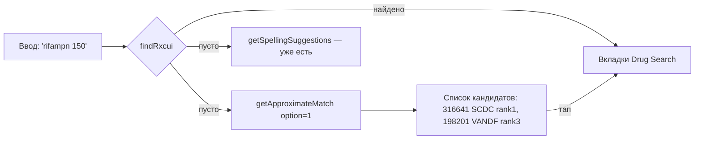
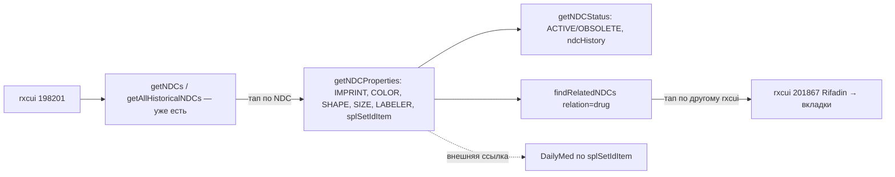
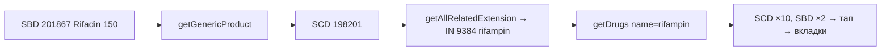
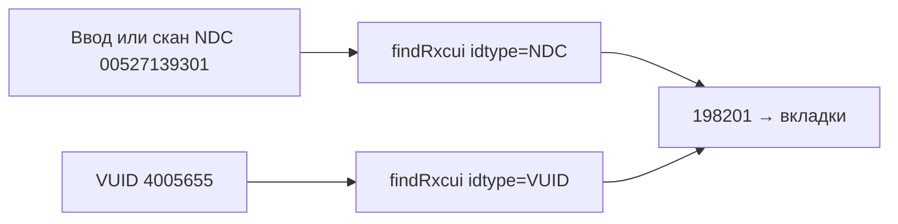
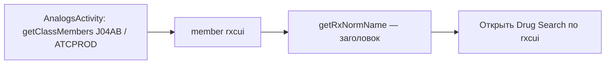

# RxNorm Roadmap — неиспользуемые операции DefaultApi

> Дата: 23.10.2026 (MSK). Источник истины: `C:\Users\combo\Desktop\RxNorm-OpenAPI\openapi.yaml`, сгенерированный `gov.nih.nlm.rxnorm.apis.DefaultApi` (62 операции, файл от 23.10.2026 14:19 MSK).
> Все примеры ниже — **реальные ответы** `https://rxnav.nlm.nih.gov/REST` от 23.10.2026 (HTTP 200), базовый препарат — **rifampin 150 MG Oral Capsule, rxcui 198201**. RxNorm version: `05-Oct-2026`, apiVersion `3.1.356`.
> Правило проекта: менять только `openapi.yaml` → регенерировать → перетестировать. Сгенерированные классы руками не править.

## 0. Что уже используется (15 операций, grep по некомментированным вызовам)

| Операция | Где |
|---|---|
| findRxcui | `RxNormLib.kt:61` |
| getSpellingSuggestions | `fragment/api2/RxNorm.kt:348` |
| getAllRxTermInfo | Fragment5 `[INFO]` :84 |
| getAllProperties | Fragment2 «RxNorm Properties» :100 |
| getRxcuiHistoryStatus | Fragment7 «Status» :93 |
| getRxConceptProperties | FragmentProperties :66 |
| getAllRelatedInfo | FragmentRelated :68 |
| getTermTypes, getRelaTypes, getRelated | FragmentRelatedByType :111/123/184 |
| getNDCs | FragmentNdc :66 |
| getAllHistoricalNDCs | FragmentNdcHistory :67 |
| getClassByRxcui | FragmentClass :82, AnalogsActivity :107 |
| getRelaSources, getClassMembers | AnalogsActivity :67/:81 |

Не используются: **24 обычных** + **23 `prescribe*`** = 47 операций.

---

## 1. Сводная таблица

Сложность: **S** — один вызов + простой вывод; **M** — новый UI-блок/цепочка; **L** — новый экран, кэш или переключатель режимов.
Приоритет: **P1** — делать первым, **P2** — полезно, **P3** — опционально, **✗** — не делать (низкая ценность / лицензия / размер).

| # | Операция | Польза для пользователя | Экран | Слож. | Приор. | Статус |
|---|---|---|---|---|---|---|
| 1 | getNDCProperties | Импринт, цвет, форма, размер, производитель, упаковка, SPL set id — **ядро pill identifier** | NDC / NDC History → карточка NDC | M | **P1** | [x] integrated [ ] device-tested |
| 2 | getNDCStatus | ACTIVE/OBSOLETE NDC, история дат, к какому rxcui относился | карточка NDC | S | **P1** | [x] integrated [ ] device-tested |
| 3 | getApproximateMatch | Находит препарат при опечатках/неполном названии, когда findRxcui пуст | Drug Search | S | **P1** | [x] integrated [ ] device-tested |
| 4 | getGenericProduct | Бренд (SBD) → дженерик (SCD) одной кнопкой | Related / шапка Drug Search | S | **P1** | [x] integrated [ ] device-tested |
| 4a | Навигация по Related / Related by Type (без новых API: getAllRelatedInfo / getRelated) | Тап по строке концепта с rxcui (например, BN Xanax → SBD 141928) открывает его в тех же 10 вкладках; история назад общая с Generic | Related, Related by Type | S | **P1** (вне очереди) | [x] integrated [ ] device-tested |
| 4b | Переход из участников класса (AnalogsActivity, getClassMembers) | Участники класса с rxcui — чипы `ConceptLinkItem` («RxCUI x · TTY» + серая строка nodeAttr); тап открывает препарат во всех 10 вкладках через `MainA2` + `KEY_RXNORMID` | Classes → AnalogsActivity | S | **P1** (вне порядка) | [x] integrated [ ] device-tested |
| 5 | getAllRelatedExtension | Related + psn, бейджи «назначаемый» (pres), human/vet, genCard | Related (замена getAllRelatedInfo) | M | **P1** | [x] integrated [ ] device-tested |
| 6 | getRxProperty (PRESCRIBABLE, AVAILABLE_STRENGTH) | Бейдж «Rx-назначаемый», дозировка в шапке | шапка Drug Search | S | P2 | [ ] integrated [ ] device-tested |
| 7 | getDrugs | Список всех лекарственных форм по названию ингредиента (SCD/SBD) | Drug Search → список | M | P2 | [ ] integrated [ ] device-tested |
| 8 | findRelatedNDCs | Все NDC того же продукта/препарата/концепта | карточка NDC | S | P2 | [x] integrated [ ] device-tested |
| 9 | findRxcui `idtype=NDC` (уже в API, новый сценарий) | Ввод/скан NDC → препарат | Drug Search (режим NDC) | S | P2 | [ ] integrated [ ] device-tested |
| 10 | getRxNormName | Быстро получить имя по rxcui (заголовок экрана из deep link / AnalogsActivity) | общий | S | P2 | [ ] integrated [ ] device-tested |
| 11 | getDisplayTerms | Офлайн-автодополнение (28 166 терминов, ~756 KB) | Drug Search (поле ввода) | L | P2 | [ ] integrated [ ] device-tested |
| 12 | Prescribe-режим (`prescribe*`, 23 оп.) | Переключатель «только назначаемые» | Drug Search + настройки | L | P2 | [ ] integrated [ ] device-tested |
| 13 | getProprietaryInformation | Коды из открытых источников (MTHSPL DP, VANDF) | Properties | S | P3 | [ ] integrated [ ] device-tested |
| 14 | filterByProperty | Проверка «это SCD?» и т.п. (да/нет) | внутренняя логика | S | P3 | [ ] integrated [ ] device-tested |
| 15 | findActiveProducts | Активный продукт для концепта (для 198201 возвращает сам себя; для remapped 1000004 — `{}`) | Status | S | P3 | [ ] integrated [ ] device-tested |
| 16 | getRxNormVersion | «Данные RxNorm от 05-Oct-2026» | About / футер | S | P3 | [ ] integrated [ ] device-tested |
| 17 | getRelaPaths | Путь связей SCD→SBD→BN (для отладки/обучения) | FragmentRelatedByType (подсказка) | S | P3 | [ ] integrated [ ] device-tested |
| 18 | getIdTypes | Справочник типов ID (21) — для спиннера в режиме поиска по ID | Drug Search (режим ID) | S | P3 | [ ] integrated [ ] device-tested |
| 19 | getPropNames / getPropCategories | Справочники (39 имён / 4 категории) для спиннера getRxProperty | dev / настройки | S | ✗/P3 | [ ] integrated [ ] device-tested |
| 20 | getSourceTypes | Справочник источников (15) | dev | S | ✗ | [ ] integrated [ ] device-tested |
| 21 | getReformulationConcepts | 5 записей (Zantac и т.п.) — почти бесполезно | — | S | ✗ | [ ] integrated [ ] device-tested |
| 22 | getMultiIngredBrand | Бренды по набору ингредиентов. **Для комбинаций вернуло пусто** (см. карточку) | — | S | ✗ (пока) | [ ] integrated [ ] device-tested |
| 23 | getAllConceptsByTTY | Bulk: BN = 5 120 концептов / 256 KB | — | M | ✗ | [ ] integrated [ ] device-tested |
| 24 | getAllConceptsByStatus | Bulk: Remapped = 50 035 / ~5 MB | — | M | ✗ | [ ] integrated [ ] device-tested |
| 25 | getAllNDCsByStatus | Bulk: Alien ≈ 10 MB | — | M | ✗ | [ ] integrated [ ] device-tested |

> **4a (23.10.2026):** строки концептов с rxcui на вкладках Related / Related by Type теперь `ConceptLinkItem` (чип `NewClickableChip`). Клик передаётся в `RxNorm` через `ConceptNavigator` (parentFragment) → `GenericProductBar.navigateTo`: одна история с Generic, до 20 шагов, чип «‹ Back to <name>», сбрасывается при новом поиске или Clear. Заголовки TTY остаются простым текстом. Если вкладку открыли не внутри Drug Search, строки остаются обычным текстом. Цепочка: xanax → 202363 (BN, 0 NDC) → 141928 (5 активных NDC) → 00009005501 → карточка таблетки. Сборки зелёные; на устройстве не проверено.

> **4b (23.10.2026):** в `AnalogsActivity` участники класса с rxcui теперь `ConceptLinkItem` (стиль `NewClickableChip`) вместо `NameValue1_2(name, tty)`; серая некликабельная строка из nodeAttr: `<источник> SourceId · SourceName · Relation` (SourceId пропускается, если совпадает с rxcui, как в ATCPROD; SourceName — если совпадает с именем). Тап → `Intent(MainA2)` + `MainA2.KEY_RXNORMID` → `RxNorm.newInstance(rxcui)` (тот же вход, что в NlmRxFragment), манифест и MainA2 не менялись; системный Back закрывает MainA2 и возвращает к списку. Заголовки остаются простыми. Живая проверка: J04AB/ATCPROD 16, AM500/VA has_VAClass 15, N05BA/ATCPROD 137, CN302/VA 47. Сборки зелёные; на устройстве не проверено.

---

## 2. Порядок итераций (маленькие волны)

Каждая волна = 1–3 операции → интеграция → тест на устройстве → отметить чекбоксы в таблице.

| Волна | Что | Почему сначала |
|---|---|---|
| **W1** | getNDCProperties (карточка NDC по тапу в NDC/NDC History) | Главная ценность для «Pill Identifier»: импринт/цвет/форма/размер |
| **W2** | getNDCStatus + findRelatedNDCs в той же карточке | Дополняет W1, тот же экран, S-сложность |
| **W3** | getApproximateMatch как fallback поиска | Сейчас при опечатке поиск пуст, есть только spelling suggestions |
| **W4** | getGenericProduct + getRxNormName (кнопка «Дженерик») | 1 вызов, понятная польза |
| **W5** | getAllRelatedExtension вместо getAllRelatedInfo + бейджи | Те же группы + psn/pres; минимальная переделка адаптера |
| **W6** | getRxProperty PRESCRIBABLE / AVAILABLE_STRENGTH в шапке | Готовит почву для W8 |
| **W7** | getDrugs (список форм) + findRxcui `idtype=NDC` | Новые сценарии входа |
| **W8** | Prescribe-переключатель | Самая большая (L), после стабилизации остального |
| **W9** | getDisplayTerms-кэш автодополнения | L: кэш, обновление по getRxNormVersion |
| **W10** | P3: proprietary, version в About, relaPaths-подсказка, idTypes | По желанию |
| — | ✗-операции | Не интегрировать (см. §6) |

---

## 3. Навигационные цепочки

### 3.1 Название → препарат (поиск с опечаткой)

Текстом: findRxcui пуст → approximateTerm (`option=1`, `maxEntries≈10`) → дедуп по rxcui → список «Возможно, вы имели в виду» → тап открывает обычные вкладки.

### 3.2 NDC → физическое описание таблетки → другие упаковки

Текстом: в NDC History старый NDC `00068051016` → ndcproperties (`ndcstatus=ALL`) показывает «RIFADIN;150», Sanofi, DROPPED → ndcstatus: OBSOLETE, rxcui 201867 → тап — переход на Rifadin.

### 3.3 Бренд → дженерик → все формы

### 3.4 NDC/ID → препарат (обратный поиск)

### 3.5 Класс → аналог → препарат

---

## 4. Карточки методов (живые примеры)

> Во всех моделях поля nullable (`String? = null`), `ignoreUnknownKeys=true`. Пустые группы сервер **опускает** — UI должен показывать «нет данных», а не падать.

### 4.1 getNDCProperties — P1, M
- **Вызов:** `GET /ndcproperties.json?id=00527139301` (id: NDC, rxcui или SPL set id; `ndcstatus=ALL` для устаревших).
- **Новые поля (реальные значения):**
  - `ndc10` = `0527-1393-01`, `splSetIdItem` = `85532a0e-24fa-4a4f-9a0e-721502fa7d7e`
  - `packagingList.packaging` = `100 CAPSULE in 1 BOTTLE (0527-1393-01)`
  - `propertyConceptList.propertyConcept`: IMPRINT_CODE `LANNETT;1393`, COLORTEXT `red(maroon/scarlet)`, SHAPE `C48336`, SIZE `18 mm`, SCORE `1`, LABELER `Lannett Company, Inc.`, MARKETING_STATUS `COMPLETED`, ANDA `ANDA065390`; `source` = `Hybrid`
  - `id=198201` → 15 NDC-записей; импринты: `150mg;N892`, `CE;185`, `E801`, `LANNETT;1393`, `LU;E01`, `Rifampin;150;VP;015`; есть SHAPETEXT.
  - `id=00068051016&ndcstatus=ALL` → Sanofi, MARKETING_STATUS `DROPPED`, NDA050420, IMPRINT `RIFADIN;150`, SIZE `14 mm`, rxcui `201867`.
- **Экран:** bottom sheet/диалог по тапу на NDC в FragmentNdc и FragmentNdcHistory (для History — `ndcstatus=ALL`). Доп.: вкладка «Imprints» по rxcui (сводка всех импринтов).
- **Нюанс:** SHAPE — код (`C48336`), человекочитаемо — SHAPETEXT; выводить SHAPETEXT, а при отсутствии код.
- **Зависимости:** нет (getNDCs уже работает).
- **Тест на устройстве:** 1) найти «rifampin 150 MG Oral Capsule»; 2) вкладка NDC → тап `00527139301` → видны импринт `LANNETT;1393`, цвет, размер 18 mm, упаковка; 3) вкладка NDC History → тап `00068051016` → `RIFADIN;150`, DROPPED; 4) режим полёта → понятная ошибка, без краша.

> **Статус (23.10.2026):** integrated, ветка `dev/ktor-api`, без коммита. Тап по NDC-чипу во вкладках NDC (`FragmentNdc`, ndcstatus по умолчанию) и NDC History (`FragmentNdcHistory`, `ndcstatus=ALL`) → диалог `NdcPillCardDialog` через `RxNormLib.ndcProperties(...)`. Новые кликабельные элементы помечены стилем `@style/NewClickableChip` (`res/values/new_clickable.xml`). Сборки `assembleLow21GoogleDebug` / `assembleLow21RustoreDebug` зелёные; на устройстве не проверено.

### 4.2 getNDCStatus — P1, S
- **Вызов:** `GET /ndcstatus.json?ndc=00527139301` (опц. `start`, `end`, `history`, `altpkg`).
- **Поля:** `status` `ACTIVE`, `rxnormNdc` `YES`, `conceptName`, `sourceList` [GS, MMSL, MMX, MTHFDA, MTHSPL, NDDF, RXNORM, VANDF], `altNdc` `N`, `ndcHistory` 200807–202610.
  `00068051016` → `OBSOLETE`, active `NO`, rxcui `201867` (Rifadin), история 200706–201012.
- **Экран:** та же карточка NDC (шапка-чип ACTIVE/OBSOLETE + таймлайн).
- **Зависимости:** W1 (общая карточка).
- **Тест:** тап по активному и устаревшему NDC → корректные чипы и даты (формат YYYYMM → «07.2008»).

> **Статус (23.10.2026):** integrated вместе с findRelatedNDCs в `NdcPillCardDialog` (секция «NDC status»: status, active, rxcui + conceptName, sources, ndcHistory в виде «07.2008 – 10.2026 rxcui 198201»). Три запроса идут параллельно, у каждой секции свои loading/error/empty. Сборки зелёные; на устройстве не проверено.

### 4.3 findRelatedNDCs — P2, S
- **Вызов:** `GET /relatedndc.json?ndc=00527139301&relation=product|drug|concept` (`ndcstatus` опц.).
- **Поля элемента:** `ndc11`, `status`, `rxcui`, `conceptName`, `conceptStatus`, `tty`.
- **Реальные объёмы:** product → 2, concept → 15, drug → 16 (включая SBD 201867, NDC `52959046110`). Для `00068051016&relation=product&ndcstatus=ALL` → 2 OBSOLETE NDC Rifadin.
- **Экран:** карточка NDC, секция «Другие упаковки» с сегментами product/drug/concept; тап по чужому rxcui → переход.
- **Тест:** relation=drug показывает запись Rifadin (SBD) → тап открывает 201867.

> **Статус (23.10.2026):** integrated. Выбран `relation=drug` (только active): все активные упаковки того же клинического препарата, включая брендовые (Rifadin 52959046110); для устаревшего NDC `product` даёт 0, а `drug` — 16 альтернатив. Каждый NDC — чип `NewClickableChip`; тап заменяет содержимое того же диалога, назад — чип «‹ Back to NDC …» или системная кнопка Back (стек до 20). Сборки зелёные; на устройстве не проверено.

### 4.4 getApproximateMatch — P1, S
- **Вызов:** `GET /approximateTerm.json?term=rifampn%20150&maxEntries=10&option=1`.
- **Поля candidate:** `rxcui`, `rxaui`, `score`, `rank`, `name`, `source`.
- **Реально:** «rifampn 150» → rank 1: 316641 `rifampin 150 MG` (SCDC); rank 3: 198201 `RIFAMPIN 150MG CAP` (VANDF). «rifampn» → 9384 rifampin. Точное имя → все кандидаты 198201, score 14.147…, rank 1.
- **Нюанс:** много дублей одного rxcui из разных источников, `name` бывает пустым у части источников → дедуп по rxcui, имя добирать через getRxNormName.
- **Экран:** Drug Search, когда findRxcui вернул пусто — список «Похожие».
- **Тест:** ввести `rifampn 150` → список, тап по 198201 → вкладки открываются.

> **Статус (23.10.2026):** integrated. Если findRxcui не нашёл rxcui, Drug Search (`RxNorm.kt`) показывает панель «Did you mean / Closest matches» (`ApproximateMatchPanel`): вызов getApproximateMatch с maxEntries=50 и option=1 (только active-концепты), атомы группируются по rxcui, на экране не больше 8 совпадений. Имя берётся из атома с source=RXNORM, а если его нет — через getRxNormName. Тап по чипу `NewClickableChip` открывает те же вкладки, что и обычный успешный поиск. Сборки зелёные; на устройстве не проверено.

### 4.5 getGenericProduct — P1, S
- **Вызов:** `GET /rxcui/201867/generic.json`.
- **Реально:** 201867 (Rifadin SBD) → 198201 (SCD); 198201 → сам себя (кнопку для SCD скрывать).
- **Экран:** шапка Drug Search / вкладка Related — кнопка «Дженерик».
- **Тест:** открыть 201867 → кнопка видна → тап → 198201; открыть 198201 → кнопки нет.

> **Статус (23.10.2026):** integrated. Над вкладками Drug Search (`RxNorm.kt`) появляется `GenericProductBar`: если getGenericProduct вернул другой rxcui (SBD/SBDC/BN/BPCK → SCD/SCDC/IN/GPCK), показывается чип «Generic: <name> ›». Для generic-концептов API возвращает сам концепт, и чип не показывается. Тап открывает те же 10 вкладок, чип «‹ Back to <brand>» возвращает к бренду (стек до 20, имя бренда берётся через getRxNormName). Ошибки не показываются — чип просто не появляется. Сборки зелёные; на устройстве не проверено.

### 4.6 getAllRelatedExtension — P1, M
- **Вызов:** `GET /rxcui/198201/allrelatedextension.json` (4 337 B).
- **Новые поля (к ConceptProperties):** `rxnavstr`, `pres`, `humandrug`, `vetdrug`, `inferedhuman`, `inferedvet`, `genCard`, `psn`, `minConceptGroup`.
  Пример: IN 9384 → rxnavstr `rifAMPin`, pres `Y`, inferedhuman `US`, genCard `SINGLE`; SBD 201867 → psn `Rifadin 150 MG Oral Capsule`, minConceptGroup BN Rifadin 202953.
- **Экран:** FragmentRelated — заменить источник данных; бейджи «Rx» (pres=Y), «Human/Vet», показывать psn как основное имя.
- **Нюанс:** пустые группы опускаются (как и в allrelated).
- **Зависимости:** операция добавляется в спеку параллельным воркером — дождаться его регенерации (в DefaultApi.kt она уже есть).
- **Тест:** вкладка Related для 198201 — те же группы, что и раньше, + psn и бейджи; сравнить с getAllRelatedInfo визуально.

> **Статус (23.10.2026):** integrated, ветка `dev/ktor-api`, без коммитов. `FragmentRelated.loadData()` теперь основной вызов `getAllRelatedExtension` (живая проверка: те же группы и строки, что у getAllRelatedInfo — 198201: 15/15, 141928: 15/15, 202363: 40/40 — плюс pres/psn/vetdrug), при ошибке, пустом теле или без allRelatedGroup — откат на прежний `getAllRelatedInfo` (`loadDataRelatedInfo()`). Каждая строка-концепт остаётся чипом `NewClickableChip` с той же навигацией; под ним некликабельный бейдж «Rx prescribable» (pres=Y, стиль `InfoBadge`, зелёный, `res/values/info_badge.xml`), бейдж «Veterinary» (vetdrug=US) и строка «Prescribable name: …», если psn отличается от имени (без учёта регистра, поэтому tall-man `rifAMPin` не дублируется). Сборки low21Google/low21Rustore debug зелёные; на устройстве не проверено.

### 4.7 getRxProperty — P2, S
- **Вызов:** `GET /rxcui/198201/property.json?propName=PRESCRIBABLE` → `Y`; `propName=AVAILABLE_STRENGTH` → `150 MG`.
- **Экран:** шапка Drug Search (чипы «Rx» и дозировка).
- **Тест:** чипы видны для 198201; для концепта без свойства — чип скрыт.

### 4.8 getDrugs — P2, M
- **Вызов:** `GET /drugs.json?name=rifampin&expand=psn`.
- **Реально:** SBD 2 (201867 Rifadin 150 Capsule, 207436 Rifadin 600 Injection), SCD 10 (198201, 198202 300 MG, 198203 isoniazid/rifampin, 198384, 199755, …); `expand=psn` добавляет psn (`rifAMPin 150 MG Oral Capsule`).
- **Экран:** Drug Search — при вводе ингредиента показывать список форм, сгруппированный по TTY.
- **Тест:** ввести `rifampin` → 12 позиций в 2 группах → тап по 198202 → вкладки.

### 4.9 findRxcui с idtype (новый сценарий существующей операции) — P2, S
- **Реально:** `idtype=NDC&id=00527139301` → `198201`; `idtype=VUID&id=4005655` → `198201`. `idtype=SPL_SET_ID` — шумно: setid из ndcproperties `85532a0e-…` → пусто, а другой setid → 20 rxcui (вперемешку IN/SCD/…), **для UI не годится**.
- **Экран:** Drug Search — режим «по NDC» (поле ввода/скан штрихкода), справочник типов — getIdTypes.
- **Тест:** ввести `00527139301` в режиме NDC → открывается 198201.

### 4.10 getRxNormName — P2, S
- **Вызов:** `GET /rxcui/198201.json` → `{"idGroup":{"name":"rifampin 150 MG Oral Capsule"}}`.
- **Экран:** заголовок при переходе по rxcui (AnalogsActivity, related NDC, approximate match).
- **Тест:** переход из AnalogsActivity — заголовок корректный до загрузки остальных вкладок.

### 4.11 getDisplayTerms — P2, L
- **Вызов:** `GET /displaynames.json` → 28 166 терминов, ~756 KB (Prescribe: 13 688).
- **Примеры:** `rifAMPin`, `isoniazid / rifAMPin`, `isoniazid / pyrazinamide / rifAMPin`, `ethambutol / isoniazid / rifAMPin`, `rifAMPin / trimethoprim`.
- **Экран:** автодополнение поля поиска (локальный кэш в файле/Room, префиксный поиск).
- **Зависимости:** getRxNormVersion — перекачивать кэш только при смене версии.
- **Тест:** первая загрузка в фоне; офлайн автодополнение `rifa` → подсказки; без повторной загрузки при перезапуске.

### 4.12 getProprietaryInformation — P3, S (лицензия!)
- **Вызов:** `GET /rxcui/198201/proprietary.json` (без srclist) → 12 записей: MTHSPL DP id `24658-801`, `42806-801`, `60687-575`, `62135-315`, `67046-1605`, `68180-658`, `70954-892`; RXNORM PSN/SCD/TMSY; VANDF AB/CD id `4005655`.
- **Ограничение:** `srclist=MMSL` → `{"proprietaryGroup":{"rxcui":null}}`. Лицензированные источники (UMLS) без UMLS-ticket **не отдаются**. Показывать только открытые источники, не обещать MMSL/GS и т.п.
- **Экран:** вкладка Properties, секция «Коды источников».
- **Тест:** 198201 → 12 строк; MMSL не запрашивать.

### 4.13 filterByProperty — P3, S
- **Реально:** `propName=TTY&propValues=SCD` → `{"rxcui":"198201"}`; `TTY=SBD` → `{}`.
- **Польза:** только внутренняя проверка (да/нет). В UI самостоятельной ценности нет.

### 4.14 findActiveProducts — P3, S
- **Реально:** 198201 → сам себя; 201867 `results=all` → сам себя; remapped 1000004 → `{}` (а getRxcuiHistoryStatus для 1000004 показывает remappedConcept 999970).
- **Вывод:** для замены устаревших rxcui полезнее уже используемый historystatus. Низкий приоритет.

### 4.15 getRxNormVersion — P3, S
- **Реально:** version `05-Oct-2026`, apiVersion `3.1.356`.
- **Экран:** About/футер; ключ инвалидации кэшей (getDisplayTerms).

### 4.16 Мета-справочники — P3/✗, S
- getIdTypes: 21 тип (AMPID … NDC, SPL_SET_ID, UNII_CODE, VUID); Prescribe — 8.
- getPropCategories: ATTRIBUTES, CODES, NAMES, SOURCES.
- getPropNames: 39 (Prescribe — 31).
- getSourceTypes: 15 (Prescribe — MTHCMSFRF, MTHSPL, RXNORM).
- getRelaPaths SCD→BN: `[SCD, SBD, BN]` — можно подсказкой в FragmentRelatedByType.
- Польза: заполнение спиннеров; лучше захардкодить/закэшировать, не дёргать на каждый экран.

### 4.17 getReformulationConcepts — ✗
- 5 записей (Zantac → «Zantac Reformulated Aug 2022», 152523 → 2607010; Baza-Protect, Fungi-Nail, Magonate, Calagel). Пользы для pill identifier нет.

### 4.18 getMultiIngredBrand — ✗ (пока не работает для комбинаций)
- `ingredientids=9384+6038`, `6038+8987+9384`, пример из документации `8591+684879`, а также `%20`-разделитель → `{"brandGroup":{"ingredientList":{"rxnormId":[null]}}}` — брендов нет. Запятая → `Path or Query Parameter error`.
- С **одним** ингредиентом работает: `9384` → BN 202953 Rifadin; `8591` → длинный список BN.
- Модель: `IngredientList.rxnormId: List<String?>?` — `[null]` парсится без ошибок.
- Вывод: для «бренды ингредиента» уже есть getRelated tty=BN; операцию не интегрировать, пока не подтвердится рабочий формат для комбинаций.

### 4.19 Bulk-операции — ✗
- getAllConceptsByTTY BN: 5 120 / 256 KB; getAllConceptsByStatus Remapped: 50 035 / ~5 MB; getAllNDCsByStatus Alien: ≈10 MB.
- На мобильном — трафик, память, ANR-риск. Не вызывать из UI.

---

## 5. Prescribe vs обычные операции

`/Prescribe/...` — подмножество RxNorm **только с назначаемыми (prescribable) концептами и открытыми источниками** (RXNORM, MTHSPL, MTHCMSFRF). Ответы того же формата → те же модели.

| Сравнение (198201 / rifampin) | Обычная | Prescribe |
|---|---|---|
| findRxcui | 198201 | 198201 |
| getAllProperties | 34 свойства | 23 (нет MMSL_CODE×2, SCHEDULE 0, SNOMEDCT, VUID, 6 не-RxNorm Sources) |
| getAllRelatedInfo | — | идентично |
| getDrugs rifampin, SCD | 10 | 3 (198201, 198202, 312821; комбинации выпали) |
| getAllConceptsByTTY BN | 5 120 | 4 140 |
| getDisplayTerms | 28 166 | 13 688 |
| getIdTypes / getSourceTypes / getPropNames | 21 / 15 / 39 | 8 / 3 / 31 |
| termtypes, relatypes | — | идентично |
| getApproximateMatch «rifampin 150» | много источников | 316641 и 566037 (Rifadin SBDC), только RXNORM |
| getRelated tty=BN | — | Rifadin |
| getSpellingSuggestions rifampn | rifampin | rifampin |
| getMultiIngredBrand | null | null |

**UX-идея:** переключатель **«Только назначаемые (Rx)»** в Drug Search (и дефолт в настройках).
- Вкл → findRxcui / approximateTerm / drugs / spelling / allProperties / related / displaynames идут в `prescribe*`; заголовок-чип «Prescribable».
- Выкл → обычные операции (полнее: VANDF/MMSL-коды, комбинации, устаревшие/непрописываемые формы).
- NDC-операции (ndcproperties, ndcstatus, relatedndc, allhistoricalndcs) — **только обычные**, prescribe-аналогов нет, переключатель на NDC-вкладки не влияет.
- Реализация: один флаг в обёртке `RxNormLib` (`if (prescribable) api.prescribeGetDrugs(...) else api.getDrugs(...)`), не трогая сгенерированный код.
- Тест: rifampin с выкл. → 10 SCD; с вкл. → 3 SCD; Properties 34 → 23.

---

## 6. Чего избегать

1. **Не править сгенерированные классы.** Только `openapi.yaml` → регенерация → тест.
2. **Bulk-эндпоинты** (allconcepts, allstatus, allNDCstatus) — не вызывать из UI (до ~10 MB).
3. **Лицензированные источники** (MMSL, GS, MMX, SNOMEDCT и др. в proprietary): без UMLS-ticket ответ пустой; не обещать их в UI, не хранить в приложении API-ключи UMLS.
4. **getMultiIngredBrand** для комбинаций — пусто; не строить на нём фичу.
5. **findRxcui idtype=SPL_SET_ID** — возвращает смесь из десятков rxcui; не использовать для навигации.
6. **Не ждать «всегда есть поле»:** пустые группы опускаются, `name` у кандидатов бывает пустым, null-элементы в массивах (`[null]`).
7. **getDisplayTerms без кэша** — 756 KB при каждом вводе недопустимо; кэш + инвалидация по getRxNormVersion.
8. **SHAPE** — это код (`C48336`); показывать SHAPETEXT.
9. **Prescribe не покрывает NDC** — не пытаться направлять NDC-вкладки в Prescribe.
10. Не дублировать сетевые вызовы между вкладками — одна выборка на rxcui, кэш в ViewModel.

---

## 7. Топ-5 первых шагов

1. W1: карточка NDC с **getNDCProperties** (импринт/цвет/форма/размер/производитель) по тапу в NDC и NDC History.
2. W2: **getNDCStatus** + **findRelatedNDCs** в той же карточке.
3. W3: **getApproximateMatch** как fallback, когда findRxcui пуст.
4. W4: кнопка «Дженерик» через **getGenericProduct** (+ getRxNormName для заголовка).
5. W5: **getAllRelatedExtension** во вкладке Related (psn, бейдж pres), затем W6 — чип PRESCRIBABLE через getRxProperty как подготовка к Prescribe-переключателю.
